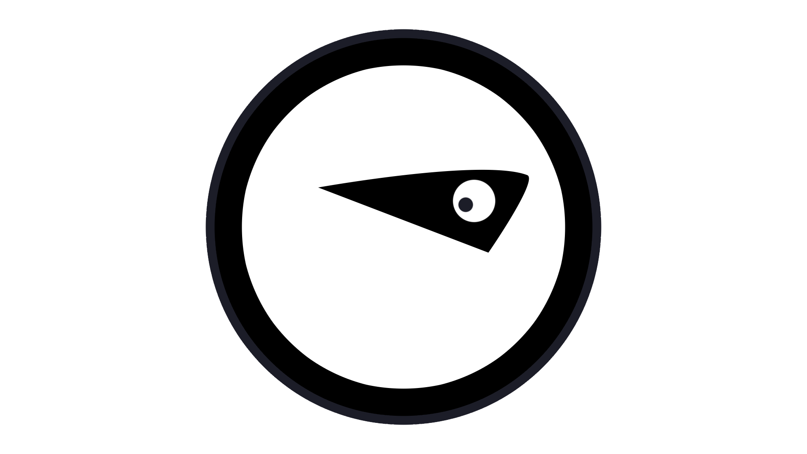

<p align="center">
  
</p>

# NodIris

An open-source and lightweight mind-mapping software that can be used to plan
and organize a project or ideas.

NodIris is a desktop mind-mapping app with a free-form canvas. Each node can
hold a note, task, web link, image, document or folder. Links show how the nodes
relate. When several ideas lead to the same result, their branches can meet in
one arrow.

It works locally and does not require an account. A map is stored in one `.ogt`
file, while linked documents stay in their original folders.


## Features

- Create notes, tasks, links, images, documents, spreadsheets, PDFs and folders.
- Connect two nodes or merge several branches into one arrow toward a shared node.
- Organize larger maps with folders that contain their own graphs.
- Choose one of the bundled Papicons or import a custom image for a node.
- Search across the current graph and its folders.
- Open notes and text files in the built-in editor.
- Preview notes, images and supported files when the pointer rests on a node.
- Export the whole graph, the visible area or a selection to PNG or PDF.
- Change the colours, font, connection style and light or dark theme.
- Undo every graph edit and save changes automatically.

NodIris runs on Linux, Windows and macOS. The project-format test stores 1,000
short notes and 999 links in about 12 KB.

## Basic use

Create or open a project from the start page. Double-click an empty part of the
canvas to add a node, or drop files from the file manager onto it.

Drag one of the small handles around a node onto another node to connect them.
The link tool also connects two nodes with two clicks. For a many-to-one link,
select each source with the left mouse button, then right-click the target. The
branches meet before a single arrow reaches the target node.

Select a node or link to edit it in the details panel. Nodes can use a Papicon
or a custom image. NodIris resizes and compresses custom images before storing
them in the project.

Folders work like smaller graphs inside the main one. Drag nodes onto a folder
to move them there. The path above the canvas shows the current folder and lets
you return to a parent graph.


## Shortcuts

| Shortcut | Action |
|---|---|
| `Ctrl+N` / `Ctrl+O` | Create or open a project |
| `Ctrl+S` | Save now |
| `Ctrl+Z` / `Ctrl+Shift+Z` | Undo or redo |
| `Ctrl+X` / `Ctrl+C` / `Ctrl+V` | Cut, copy or paste |
| `Ctrl+A` | Select every node in the current folder |
| `Delete` | Delete the selection |
| `Ctrl+F` | Search, then jump to the next result with Enter |
| `Ctrl+D` | Duplicate the selected node |
| `F2` | Rename the selected node |
| `Ctrl+0` | Fit the graph in the window |
| `Ctrl+=` / `Ctrl+-` | Zoom in or out |
| `Ctrl+I` | Show or hide the details panel |
| `Ctrl+Shift+L` | Switch between the light and dark themes |
| `Ctrl+Shift+E` | Export the graph to PNG or PDF |
| `Escape` / `Alt+Up` | Leave the current folder |
| Middle mouse button, or Space and drag | Move around the canvas |

## Project files

NodIris saves a project as a single `.ogt` file. The graph data uses CBOR with
integer keys and zlib compression. The format is documented in
[docs/format.md](docs/format.md).

NodIris does not copy linked files. It stores their paths relative to the `.ogt`
file, so the project and its documents can move or sync as one folder. Images
keep a 160-pixel preview in the project. Custom node icons are limited to 96
pixels on their longest side.

## Build from source

The project requires:

- CMake 3.21 or newer
- a C++20 compiler
- Qt 6.5 or newer with Core, Gui and Widgets
- the Qt SVG plugins used to load the embedded Papicons

Qt Linguist Tools are optional and are only needed to build the French
translation.

### Linux

On Debian or Ubuntu:

```sh
sudo apt update
sudo apt install build-essential cmake ninja-build qt6-base-dev qt6-svg-plugins qt6-l10n-tools
cmake --preset linux-release
cmake --build --preset linux-release --parallel
ctest --preset linux-release
cmake --install build/linux-release --prefix dist
./dist/bin/NodIris
```

### macOS

Install Xcode Command Line Tools and Qt with Homebrew:

```sh
xcode-select --install
brew install cmake ninja qt
cmake --preset macos-release -DCMAKE_PREFIX_PATH="$(brew --prefix qt)"
cmake --build --preset macos-release --parallel
ctest --preset macos-release
cmake --install build/macos-release --prefix dist
open dist/NodIris.app
```

### Windows

Install Visual Studio 2022 with the Desktop development with C++ workload,
CMake, and Qt 6.5 or newer. In a Developer PowerShell, set
`CMAKE_PREFIX_PATH` to the installed MSVC Qt kit:

```powershell
$env:CMAKE_PREFIX_PATH = "C:\Qt\6.8.3\msvc2022_64"
cmake --preset windows-release
cmake --build --preset windows-release --parallel
ctest --preset windows-release
cmake --install build/windows-release --prefix dist --config Release
.\dist\bin\NodIris.exe
```

The generic preset also works on a configured development machine:

```sh
cmake --preset release
cmake --build --preset release --parallel
ctest --preset release
./build/release/NodIris
```

## Create a release

Update the version in the `project()` line of `CMakeLists.txt`, then push a tag
such as `v0.2.0`. The release workflow builds and publishes a Windows x64 NSIS
installer and an amd64 Debian package for Ubuntu/Debian. It can also be run
manually from the Actions tab to download both packages without creating a
GitHub release.

To create a Linux package locally against Qt installed by your distribution,
run:

```sh
cmake --preset linux-release -DOGT_BUILD_TOOLS=OFF
cmake --build --preset linux-release --parallel
cpack --config build/linux-release/CPackConfig.cmake -G DEB
```

On Windows, use a Developer PowerShell with NSIS installed:

```powershell
cpack --config build/windows-release/CPackConfig.cmake -C Release -G NSIS
```

## Code structure

`src/core` contains the graph model, project format, image compression and grid
alignment. It depends only on Qt Core and Qt Gui. `src/ui` contains the canvas,
editor, previews, details panel and main window. `GraphScene` records graph
changes in the undo history.


## Contributing

Bug reports and focused pull requests are welcome. Before submitting a code
change, build the project and run the tests with the matching CMake preset.

## Credits and licence

NodIris was created by Honiway, is built with [Qt](https://www.qt.io/) and is
released under the MIT licence. See [LICENSE](LICENSE).

The interface icons come from
[Papicons](https://github.com/PapillonApp/Papicons), a pack made for Papillon
and released under the MIT licence by Association Papillon. A copy of that
licence is included in
[licenses/Papicons-LICENSE.txt](licenses/Papicons-LICENSE.txt).
